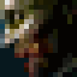
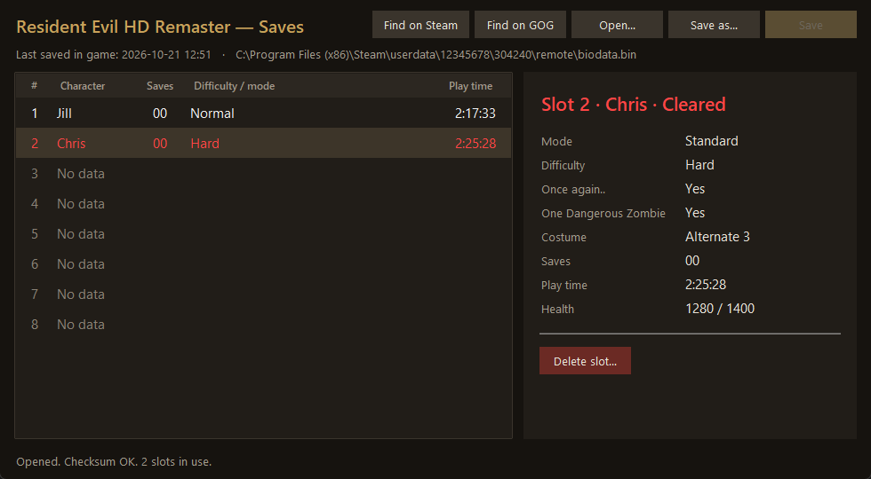

<p align="center">
  
</p>

<h1 align="center">RE HD Save Manager</h1>

<p align="center">
  See what is inside your <b>Resident Evil HD Remaster</b> (PC) save file: every slot, its play time,
  mode and difficulty — and safely delete the slots you no longer want.
</p>

<p align="center">
  <a href="https://github.com/wwlckr/rehdsm/releases/latest"></a>
  <a href="https://github.com/wwlckr/rehdsm/releases"></a>
  
  <a href="LICENSE"></a>
</p>

<p align="center">
  
</p>

---

## Contents
- [Features](#features)
- [Download](#download)
- [How to use](#how-to-use)
- [Important before you save](#important-before-you-save)
- [FAQ](#faq)
- [Running from source and building](#running-from-source-and-building)
- [Reporting a problem](#reporting-a-problem)
- [Roadmap](#roadmap)
- [Credits and license](#credits-and-license)

## Features
- **All 8 slots at a glance**, in the same order and with the same colours as the game's *Load* menu.
- **Play time** of every slot.
- Character, number of saves, **mode** (Standard, Real Survival, Invisible Enemy), **difficulty**, costume and health.
- Detects **completed files** ("Cleared"), games started with **"Once again.."** and 
  **One Dangerous Zombie**.
- **Delete slots**: they become "No data", exactly as the game leaves an empty slot. A **backup** of your file is made
  before every write.
- **Finds your save automatically** on Steam or GOG (Steam is checked first).
- **Drag and drop** a `biodata.bin` onto the window to open it.
- Portable: a single `.exe`, nothing to install.

### Colour legend
The list uses the same colours as the game:

| Colour | Meaning |
|---|---|
| Magenta | Very Easy |
| Green | Easy |
| White | Normal |
| Red | Hard |
| Blue | Real Survival |
| Orange | Invisible Enemy |

## Download
Get the latest version from the **[Releases page](https://github.com/wwlckr/rehdsm/releases/latest)**.

| File | Works on |
|---|---|
| `rehdsm-<version>-windows-x86.exe` | Windows 7 SP1 or newer, **32-bit or 64-bit**. |
| `rehdsm-<version>-windows-x64.exe` | Windows 7 SP1 or newer, 64-bit only. |

Each release lists the **SHA256** checksums of both files, so you can verify your download
(PowerShell: `Get-FileHash .\rehdsm-<version>-windows-x86.exe`).

## How to use
1. Run the `.exe`. It opens your save on its own if it finds one (Steam first, then GOG).
   Otherwise use **Open…**, **Find on Steam** / **Find on GOG**, or drag your `biodata.bin` onto the window.
2. Click a slot to see its details on the right.
3. To delete a slot: select it → **Delete slot…** (or the <kbd>Delete</kbd> key) → **Save** (<kbd>Ctrl</kbd>+<kbd>S</kbd>).
   Nothing is written until you press **Save**.

### Where is my save?
| Version | Folder |
|---|---|
| Steam | `C:\Program Files (x86)\Steam\userdata\<your Steam ID>\304240\remote\biodata.bin` |
| GOG | `%LOCALAPPDATA%\GOG.com\Galaxy\Applications\58424498340553405\Storage\Shared\Files` |

## Important before you save
- **Close the game first.** Otherwise the game may overwrite your changes, or you may overwrite its newer save.
- **Steam Cloud**: Steam syncs `biodata.bin`. If Steam reports a *Cloud Sync Conflict* the next time you launch the
  game, choose the **local** files to keep your changes.
- **Backups**: before every save, the original file is copied to a `backups` folder **next to the `.exe`**
  (`backups\biodata_YYYYMMDD-HHMMSS.bin`). To undo a change, close the game and copy the backup over your
  `biodata.bin` (rename it back to `biodata.bin`).

## FAQ
**Can it edit health, items or the play time?**
No. It is a save *manager*, not a save editor (at least for now). The only change it can make is deleting slots.

**Is it safe?**
It only writes when you press **Save**, after asking for confirmation, and it always makes a backup first. The file is
re-encrypted and its checksum recomputed exactly as the game does; deleted slots are byte-identical to the empty slots
the game itself writes. Still, keep your own copy of important saves.

## Running from source and building
Requires Python 3.7 or newer with tkinter (included in the official Python installer).

```powershell
pip install -r requirements.txt
python save_manager.py                     # or: python save_manager.py path\to\biodata.bin
```

### Building the executables
```powershell
# Downloads portable Python 3.7.9 (x86/x64), Tcl/Tk, PyInstaller and the Microsoft Universal C Runtime
# into buildtools\ (about 150 MB; nothing is installed, and every download is verified against a SHA256 checksum).
powershell -ExecutionPolicy Bypass -File setup_buildtools.ps1

powershell -ExecutionPolicy Bypass -File build.ps1 -Python buildtools\python37-x86\python.exe -Ucrt buildtools\ucrt\x86
powershell -ExecutionPolicy Bypass -File build.ps1 -Python buildtools\python37-x64\python.exe -Ucrt buildtools\ucrt\x64
```
The executables are written to `dist\`.

Why Python 3.7 and the bundled runtime? Python 3.8 and newer need update KB2533623 on Windows 7, and Windows 7/8
without update KB2999226 lack the Universal C Runtime. With both, the program runs on any Windows 7 SP1, even without
updates. Building with a newer Python (`build.ps1 -Python python`) also works, but the result requires Windows 10 or
an up-to-date Windows 7.

### Project layout
| Path | What it is |
|---|---|
| `resave/crypto.py` | Blowfish encryption and SHA-1 checksum of `biodata.bin` |
| `resave/model.py` | Slots and their fields; Steam and GOG save detection |
| `resave/gui.py` | The window (tkinter) |
| `resave/dnd.py` | Drag and drop of files (Windows API) |
| `resave/data/empty_slot.bin` | Empty slot, identical to what the game writes |
| `build.ps1`, `setup_buildtools.ps1` | Build scripts |

## Reporting a problem
Open an [issue](https://github.com/wwlckr/rehdsm/issues) and include:
- your Windows version (and 32 or 64-bit),
- Steam or GOG,
- what you did and what happened (a screenshot helps a lot),
- if possible, the `biodata.bin` that causes the problem (zip it first).

## Roadmap
Ideas for future versions:
- Names of the save rooms (where each game was saved).
- Show the weapons and items in the inventory and the item box (and perhaps edit them).
- Copy slots from one save file to another.

## Credits and license
Made by **[wwlckr](https://github.com/wwlckr)**.

Copyright © 2026 wwlckr. This program is free software: you can redistribute it and/or modify it under the terms of
the **[GNU General Public License v3.0](LICENSE)**. The release executables include third-party components; see
[THIRD_PARTY_NOTICES.md](THIRD_PARTY_NOTICES.md).

*Resident Evil* is a trademark of CAPCOM. This is an unofficial fan-made tool, not affiliated with or endorsed by CAPCOM.
